# 📚 Meu Catálogo de Livros — GraphQL

## 📖 Sobre o Projeto

O projeto **Meu Catálogo de Livros** foi desenvolvido como
atividade prática da disciplina de Programação Multiplataforma,
com o objetivo de aplicar os conceitos de GraphQL na criação
e no consumo de uma API.

A aplicação permite gerenciar um catálogo pessoal de livros,
realizando operações como cadastro, consulta, atualização
do status de leitura, avaliação e exclusão de registros.

O sistema também possui funcionalidades de busca por título,
filtros por status e um painel de estatísticas, que apresenta
informações sobre os livros cadastrados e o progresso de leitura.

O backend foi desenvolvido em Python, utilizando FastAPI e
Strawberry GraphQL. Já o frontend foi construído com HTML,
CSS e JavaScript, realizando a comunicação com a API por
meio de requisições GraphQL.

---

## 🛠️ Tecnologias Utilizadas

### Backend

- **Python:** desenvolvimento da lógica da aplicação.
- **FastAPI:** criação e configuração da API.
- **Strawberry GraphQL:** implementação do schema, queries,
  mutations e resolvers.
- **Uvicorn:** execução do servidor da aplicação.

### Frontend

- **HTML5:** estrutura da interface web.
- **CSS3:** estilização e organização visual.
- **JavaScript:** interatividade e comunicação com a API.
- **Fetch API:** realização das requisições GraphQL.

### Ferramentas

- **Visual Studio Code:** desenvolvimento do projeto.
- **GraphiQL:** execução e testes das operações GraphQL.
- **Git e GitHub:** versionamento e armazenamento do código.

---

## 📂 Estrutura de Pastas

```text
Catalogo_Livros/
│
├── catalogo-api/
│   ├── main.py
│   ├── schema.graphql
│   └── requirements.txt
│
├── frontend/
│   ├── index.html
│   ├── style.css
│   └── main.js
│
├── prints/
│   ├── Print_Mudar_Status_Livros.png
│   ├── Print_Excluir_Livro.png
│   ├── Print_Dando_Nota_Livro.png
│   ├── Print_Status_Livros.png
│   ├── Print_Busca_Livro.png
│   ├── Print_Consulta_Livros.png
│   ├── Print_Cadastro_Livros_Graphql.png
│   ├── Print_Atualizar_Livros_Graphql.png
│   ├── print_avaliar_livro_graphql.png
│   ├── Print_Avaliar_Livro_2.png
│   └── Print_Teste_Validacao_Erro_Graphql.png
│
├── respostas.md
├── .gitignore
└── README.md
```

### Organização do Projeto

- **catalogo-api:** contém a implementação do backend,
  incluindo o schema GraphQL, queries, mutations,
  resolvers e validações.

- **frontend:** contém os arquivos responsáveis pela
  interface e pela comunicação com a API.

- **prints:** armazena as capturas de tela dos testes
  realizados no frontend e no GraphiQL.

- **respostas.md:** contém as respostas das questões
  teóricas propostas na atividade.

- **README.md:** apresenta a documentação do projeto,
  suas funcionalidades e evidências dos testes.

---

## 🖥️ Demonstração do Frontend

A interface web permite gerenciar os livros cadastrados,
acompanhar o progresso de leitura e visualizar estatísticas.

### 1. Alteração do status de leitura

O usuário pode alterar o status dos livros entre
"Quero ler", "Lendo" e "Lido".

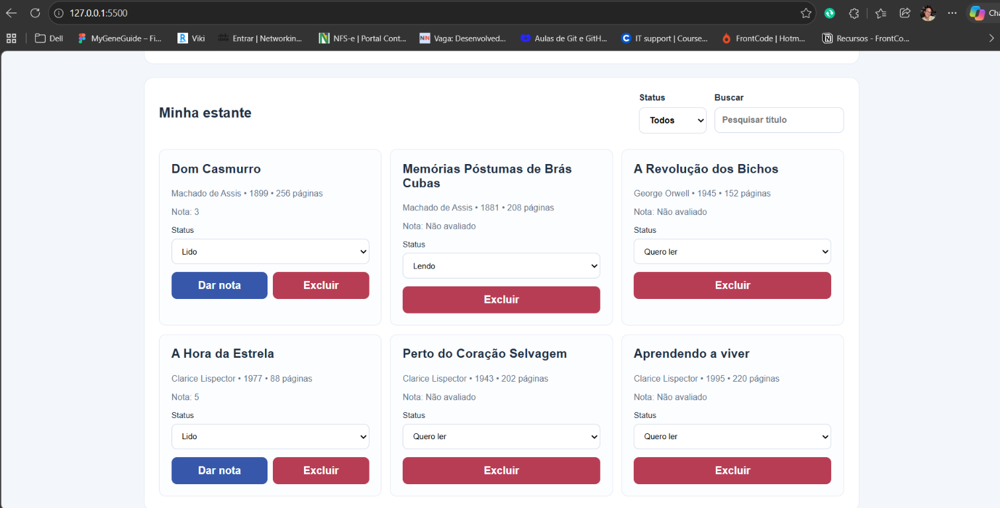

### 2. Exclusão de livros

Antes de realizar uma exclusão, o sistema solicita
uma confirmação para evitar a remoção acidental.

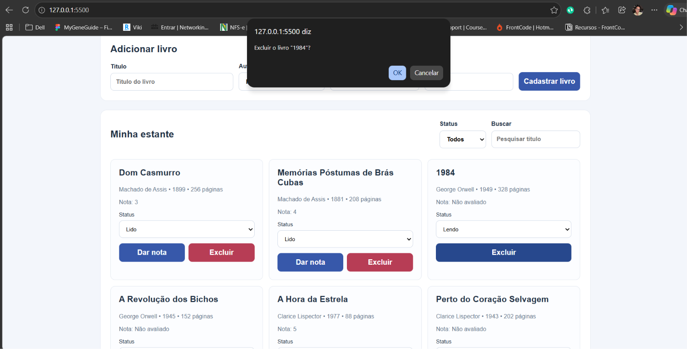

### 3. Avaliação de livros

Os livros finalizados podem receber notas de 1 a 5.
O sistema atualiza a avaliação após a alteração.

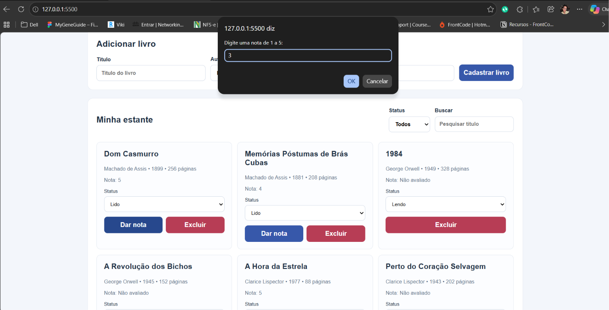

### 4. Filtro por status

A interface permite filtrar os livros por status
de leitura, exibindo apenas os registros correspondentes.

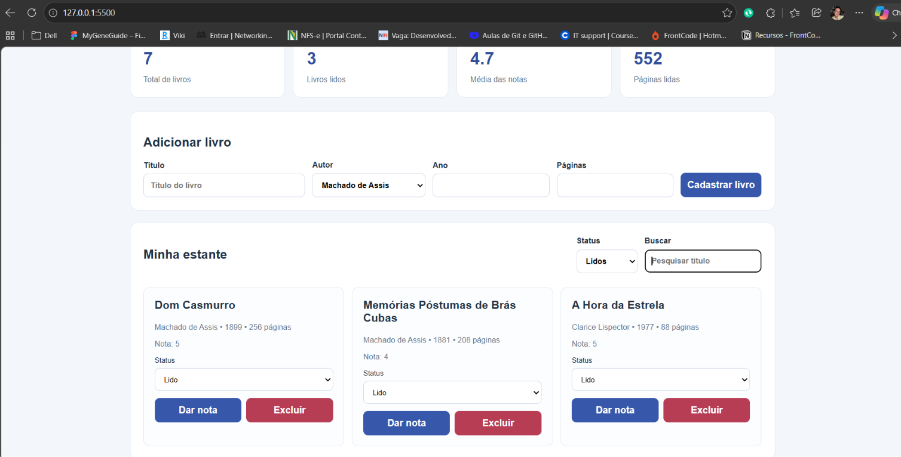

### 5. Busca de livros

A busca permite encontrar livros pelo título utilizando
variáveis GraphQL e debounce de 300 milissegundos.

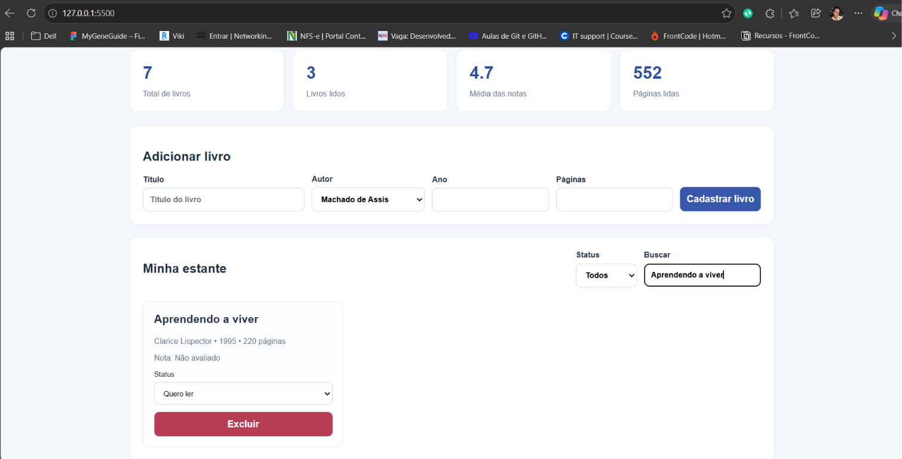

---

## 🔎 Testes da API com GraphiQL

Os testes foram realizados no GraphiQL para verificar
as consultas, mutations e validações implementadas.

### 1. Consulta de livros, autores e estatísticas

Foi realizada uma query para consultar livros,
informações dos autores e estatísticas em uma
única requisição.

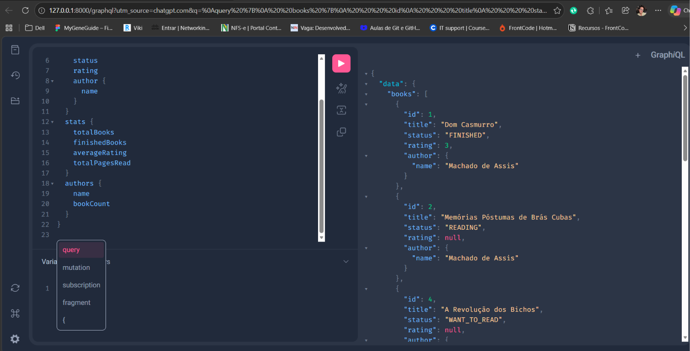

### 2. Cadastro de livros

A mutation `addBook` permite cadastrar um novo livro,
informando título, ano, páginas e identificador do autor.

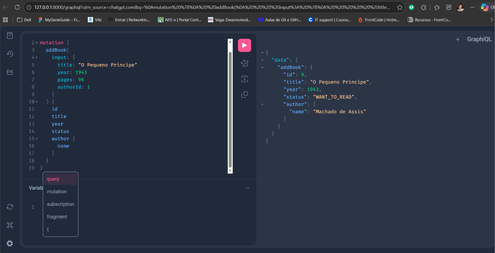

### 3. Atualização do status de leitura

A mutation `updateBookStatus` permite alterar o status
de leitura de um livro cadastrado.

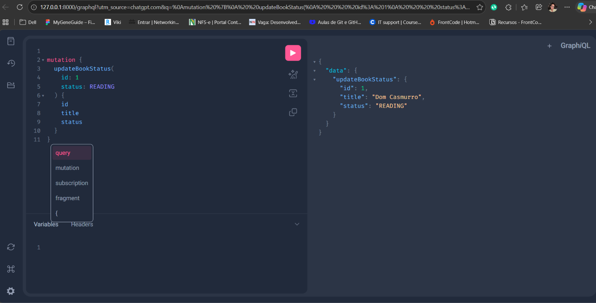

### 4. Finalização da leitura

O livro foi marcado como finalizado antes de
receber uma avaliação.

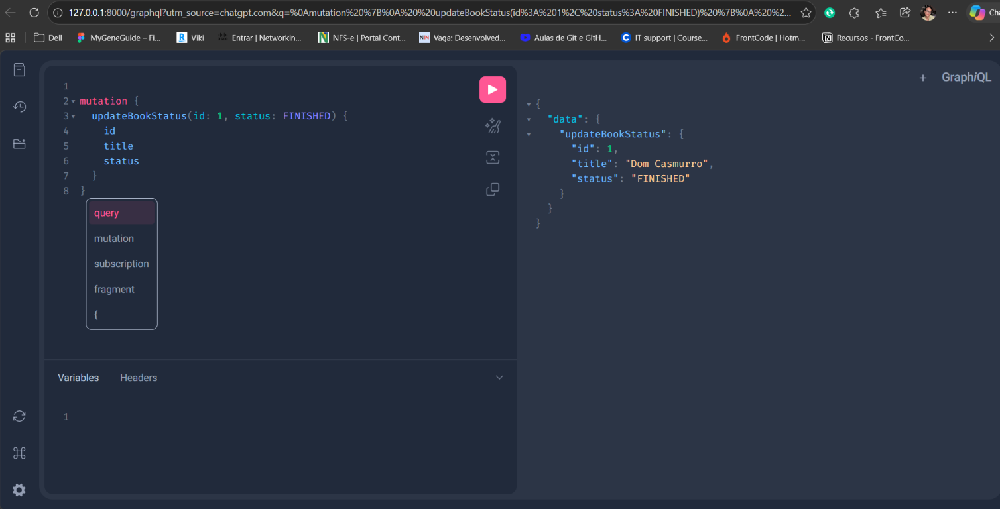

### 5. Avaliação de livros

A mutation `rateBook` permite avaliar livros
finalizados com notas de 1 a 5.

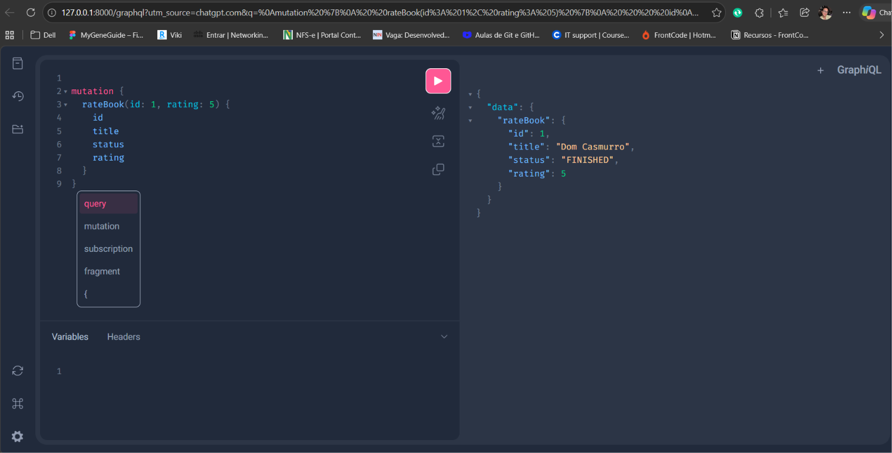

### 6. Teste de validação de erro

Foi realizada uma tentativa de atribuir a nota 9
a um livro. A API retornou um erro informando que
a nota deve estar entre 1 e 5.

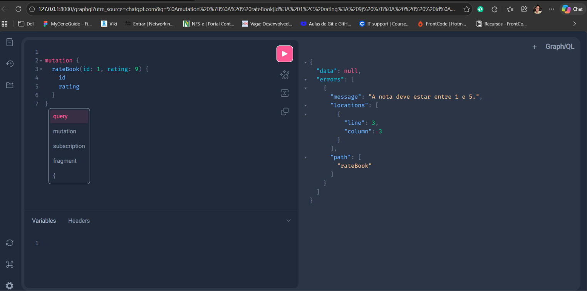

---

## 👩‍💻 Autora

**Isabella Monsalles Barosa**

Projeto acadêmico desenvolvido para a disciplina de
Programação Multiplataforma.
